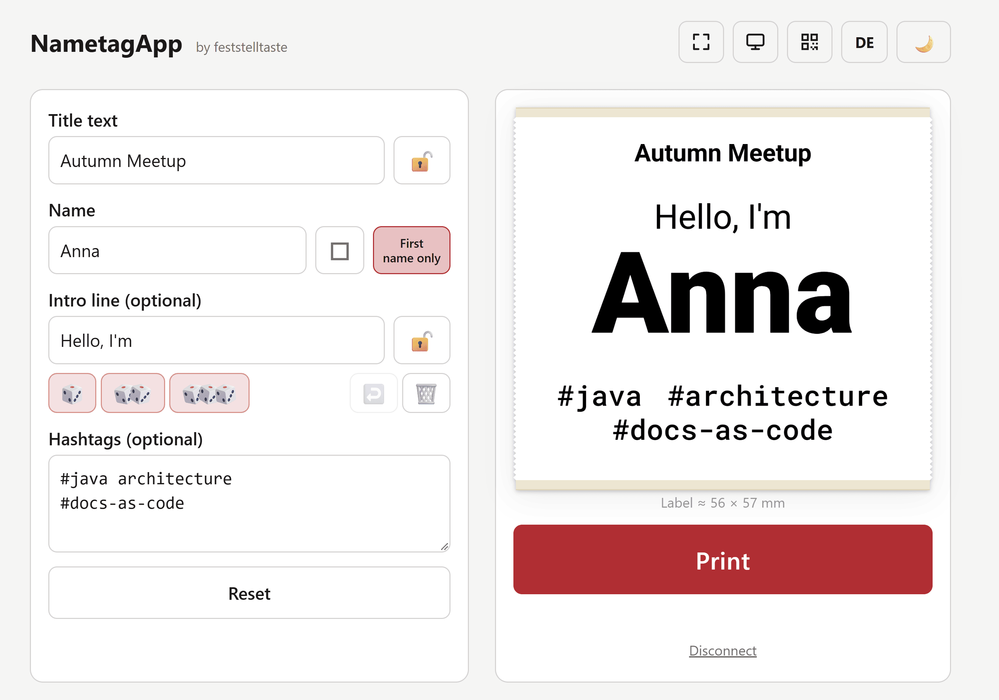
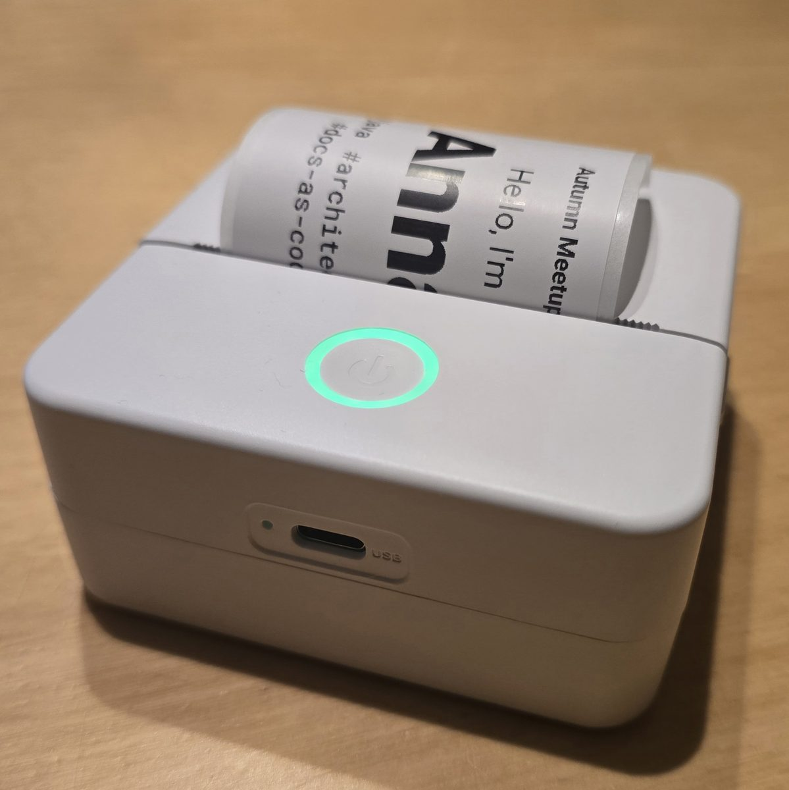

# NametagApp

**A small app for creating name tags with a Cat thermal printer.**
Type a name, pick a few words, press print: the label goes straight from your browser to the printer over Bluetooth. No server, no installation, no account.

*by feststelltaste · [Deutsch](#deutsch) · [For developers](#for-developers)*

<table align="center">
<tr>
<td valign="middle"></td>
<td valign="middle"></td>
</tr>
<tr><td align="center"><sub>The app / Die App</sub></td><td align="center"><sub>The printed label on the PRAOAHEI X6 / Das gedruckte Etikett auf dem PRAOAHEI X6</sub></td></tr>
</table>

---

## Quick start

1. Open the app in **Chrome or Edge** (a computer or an Android phone; Firefox and Safari do not support Web Bluetooth).
2. Switch the printer on and make sure no phone is connected to it.
3. Fill in the label and press **Print**. The first time, the browser asks you to pick the printer from the Bluetooth devices nearby.

## What you can do

- **Label:** a title on top, the name in large letters, an optional intro line and optional hashtags at the bottom. Every line you type in the hashtag field stays its own line. The label is drawn in Roboto and Roboto Mono (shipped with the app), so it looks the same on every device.
- **First name only:** the button next to the name field prints just the first name. It switches itself back on after every print.
- **Locks:** the locks next to the title and the intro line keep them when you press **Reset** (and, for the intro line, when it is re-rolled after a print). Without a lock, **Reset** empties them too.
- **Intro line:** write your own or roll positive adjectives with the dice (one, two or three), for example "Awesome, brilliant & brave". In German there are male and female forms, and after an article the adjective is written in lower case ("Der kluge").
- **Attendee list:** load a CSV export from Meetup (or a text file with one name per line).
  - Pick the column that holds the name, by title or by number, and say whether the first row contains column titles.
  - While you type a name, the field suggests names from the list. Printed names are checked off automatically, or check them off with the box next to the name.
  - Without a list, or for names that are not on it, **checking off the name (or printing it) adds the person to the list**. Names are only added that way. The list can be downloaded as CSV at any time.
  - **Download CSV** saves the list with the check marks; upload that file later and the check marks come back. **Click here to clear it** (or **Remove list**) deletes the list from the browser, after a confirmation dialog.
- **Connect, then print:** the print button reads **Connect printer** until a printer is connected (the first tap only connects). After that it reads **Print**. A small **Disconnect** link below it asks for confirmation first; switching the printer off disconnects as well. Messages such as "Connecting …" appear right below the button.
- **Print settings:** label length (automatic, up to 100 mm, or fixed; the roll is always 57 mm wide, 48 mm are printed), zoom 1 / 0.75 / 0.5 for smaller text and shorter labels, side margins 0 / 0.5 / 1 cm (default 0: the printer leaves about 0.8 cm of paper blank at both ends anyway; the preview shows that blank paper with a dashed line, and *Printer's own margin* in the settings changes its width for other printers, it is not printed), reversed print direction, re-roll the intro line after each print.
- **Second screen:** *Live view in new window* (or the monitor icon in the top right) opens a second window, for example on another monitor, that shows the current label big (use the browser zoom to resize; the button bottom left switches to full screen). Under *Settings* you can set an optional welcome text for it, a large line and a smaller one below (default "Welcome!" / "Get your name tag here!"; the trash can clears it).
- **Speech bubbles:** on the live view, oval speech bubbles follow the field with the cursor (name, intro line, hashtags) and point to its place on the label, for example "Tell us your name" or "Which Anna are you?". Grey example hashtags and adjectives fade in and out as inspiration. In the settings you can switch the bubbles off and write your own texts (`{name}` is replaced by the name on the label). They work in a second window of the same browser, not on another device.
- **Second screen on another device (optional):** the QR icon in the top right opens a dialog. Nothing is sent until you press **Start sharing**. Then a phone or tablet scans the QR code and shows the label live; with *New QR code after each print* every guest only keeps their own name tag. The guest first sees a notice (German or English, with buttons to switch) and must agree; then a **Looks good** button closes the connection again and tells the editor, which shows **Guest: OK** next to the print button. This goes end-to-end encrypted through the public relay ntfy.sh, a third party, see Privacy below. If you do not want that, use the second window on a local monitor.
- **Look:** dark mode, a main color of your choice (any CSS color code), English and German (the button in the top right switches; English is the default). On phones the page is compact, so the fields, the preview and the print button fit on one screen; a full-screen button is shown where the browser supports it (on an iPhone use "Add to Home Screen").

## Printer

Developed and tested with the **PRAOAHEI X6** mini printer (model X6, a Cat-style thermal printer; 57 mm paper roll, 48 mm print width). By default the browser's Bluetooth chooser lists all devices nearby and you pick your printer. Below the connect button, **Bluetooth filter** lets you enter the beginning of the device name (several names separated by commas, for example `X6h`, which is how the X6 shows up) so that only matching devices are offered; the filter is remembered. Other printers that speak the same Cat Printer protocol may work; only the X6 has been tested. The label is printed sideways so the text runs along the paper.

## Privacy

Everything stays in your browser. Attendee lists, settings and the last label live in the browser's local storage and are never uploaded. **Do not commit real attendee lists to a repository.**
Nothing leaves your computer unless you start *sharing to another device*. Then it happens in two steps:

1. **When you press Start sharing**, the page connects to the public service **ntfy.sh** (run by ntfy LLC) to wait for a device. The connection is made **directly from your browser** (not via GitHub). The service sees **your IP address**, the address of the page (`feststelltaste.github.io`), your browser type and a random room ID, but no label data and no cookies.
2. **When a phone or tablet opens the QR code**, the page itself comes from GitHub Pages, so **GitHub sees the guest's IP address** as soon as the link is opened; the notice says so. It then shows the guest a **notice in their own language** (German or English, switchable) that explains what is sent and to whom, and connects to ntfy.sh **only after the guest agrees**. Without agreement no label data is transferred and nothing is sent to ntfy.sh. After agreeing, the label data (title, name, intro line, hashtags and the second screen text) is sent to that room, **end-to-end encrypted** (AES-GCM; the key is only in the QR code, never sent to a server). Every message carries a rising time stamp, and the guest page drops older or duplicate ones, so a cached message cannot be replayed. The service stores the encrypted messages for up to **12 hours** and also sees the **IP addresses** of both devices and the timing. After each print a new, empty room is used, so a guest never sees someone else's name. Anyone who photographs the QR code on the screen can follow the room until the next code is created.

Free use needs no account but is limited (no guarantee of availability). ntfy.sh limits requests and the number of simultaneous connections **per IP address** (by default 30 subscriptions and a burst of 60 requests), and everyone on the same Wi-Fi shares one address. With many guests at once the sharing can fail; the **Looks good** button frees the connection early. See ntfy's [privacy policy](https://docs.ntfy.sh/privacy/) and [terms](https://docs.ntfy.sh/terms/). Whether you need a **data processing agreement** (Auftragsverarbeitungsvertrag) or have to inform participants is your decision as organizer; this README is not legal advice.

The attendee list, settings and the last label are kept in `localStorage`. All pages under `feststelltaste.github.io` share one origin, so other pages hosted there could read this data in the same browser.

---

## Deutsch

**NametagApp** druckt Namensschilder direkt aus dem Browser auf einen Cat-Thermodrucker, über Bluetooth. Ohne Server, ohne Installation, ohne Konto.

### Schnellstart

1. Die App in **Chrome oder Edge** öffnen (Computer oder Android-Handy; Firefox und Safari unterstützen Web Bluetooth nicht).
2. Drucker einschalten. Er darf nicht mit dem Handy verbunden sein.
3. Etikett ausfüllen und **Print** (Drucken) klicken. Beim ersten Mal fragt der Browser, welchen Drucker du aus den Bluetooth-Geräten in der Nähe nimmst.

Die App startet auf Englisch. Mit dem Button **DE** oben rechts schaltest du auf Deutsch um; die Wahl wird gemerkt.

### Funktionen

- **Etikett:** Titel oben, Name in großen Buchstaben, optionale Zwischenzeile und optionale Hashtags unten. Jede Zeile im Hashtag-Feld bleibt eine eigene Zeile. Das Etikett wird in Roboto und Roboto Mono gezeichnet (liegen der App bei), sieht also auf jedem Gerät gleich aus.
- **Nur Vorname:** Der Button neben dem Namensfeld druckt nur den Vornamen. Er springt nach jedem Druck von selbst wieder an.
- **Schlösser:** Die Schlösser neben dem Titel und der Zwischenzeile schützen sie vor **Zurücksetzen** (die Zwischenzeile auch vor dem Neuwürfeln nach dem Druck). Ohne Schloss leert **Zurücksetzen** sie mit.
- **Zwischenzeile:** Selbst schreiben oder mit den Würfeln positive Adjektive würfeln (eins, zwei oder drei), zum Beispiel „Großartige(r), geniale(r) & mutige(r)". Mit 👨 und 👩 wählst du die männliche oder weibliche Form; nach einem Artikel steht das Adjektiv klein („Der kluge").
- **Teilnehmerliste:** CSV-Export von Meetup laden (oder eine Textdatei mit einem Namen pro Zeile).
  - Wähle die Spalte mit dem Namen (nach Titel oder Nummer) und gib an, ob die erste Zeile Spaltentitel enthält.
  - Beim Tippen schlägt das Namensfeld Namen aus der Liste vor. Gedruckte Namen werden automatisch abgehakt, oder du hakst sie mit dem Kästchen neben dem Namen ab.
  - Ohne Liste, oder bei Namen, die nicht darauf stehen, **kommt die Person auf die Liste, sobald du den Namen abhakst (oder druckst)**. Nur so werden Namen hinzugefügt. Die Liste lässt sich jederzeit als CSV herunterladen.
  - **CSV herunterladen** speichert die Liste mit den Haken; lädst du die Datei später wieder hoch, kommen die Haken zurück. **Hier klicken zum Entleeren** (oder **Liste entfernen**) löscht die Liste aus dem Browser, nach einer Rückfrage im Dialog.
- **Erst verbinden, dann drucken:** Der Druckknopf heißt **Drucker verbinden**, solange kein Drucker verbunden ist (der erste Tipp verbindet nur). Danach heißt er **Drucken**. Ein kleiner Link **Verbindung trennen** darunter fragt vorher nach; auch das Ausschalten des Druckers trennt. Meldungen wie „Verbinde …" stehen direkt unter dem Knopf.
- **Druckeinstellungen:** Etikettenlänge (automatisch bis 100 mm oder fest; die Rolle ist immer 57 mm breit, bedruckt werden 48 mm), Zoom 1 / 0,75 / 0,5 für kleinere Schrift und kürzere Etiketten, Seitenränder 0 / 0,5 / 1 cm (Standard 0: der Drucker lässt ohnehin etwa 0,8 cm Papier an beiden Enden frei; die Vorschau zeigt dieses leere Papier mit einer gestrichelten Linie, und *Eigener Rand des Druckers* in den Einstellungen ändert seine Breite für andere Drucker, gedruckt wird er nicht), Druckrichtung umkehren, Zwischenzeile nach jedem Druck neu würfeln.
- **Zweiter Bildschirm:** „Live-Ansicht in neuem Fenster" (oder das Monitor-Symbol oben rechts) öffnet ein zweites Fenster, zum Beispiel auf dem anderen Monitor, das das aktuelle Etikett groß zeigt (zum Vergrößern den Browser-Zoom benutzen; der Knopf unten links schaltet auf Vollbild). Unter *Einstellungen* kannst du einen optionalen Willkommenstext setzen, eine große und eine kleinere Zeile darunter (Standard „Willkommen bei uns!" / „Hier gibt es dein Namensschild!"; der Papierkorb leert ihn).
- **Sprechblasen:** In der Live-Ansicht folgen ovale Sprechblasen dem Feld mit dem Cursor (Name, Zwischenzeile, Hashtags) und zeigen auf dessen Platz auf dem Etikett, zum Beispiel „Verrate uns deinen Namen" oder „Welche Anna bist du?". Graue Beispiel-Hashtags und -Adjektive blenden als Inspiration auf und ab. In den Einstellungen kannst du die Sprechblasen ausschalten und eigene Texte schreiben (`{name}` wird durch den Namen auf dem Etikett ersetzt). Sie funktionieren in einem zweiten Fenster desselben Browsers, nicht auf einem anderen Gerät.
- **Zweiter Bildschirm auf einem anderen Gerät (optional):** Das QR-Symbol oben rechts öffnet ein Fenster. Gesendet wird erst, wenn du **Teilen starten** drückst. Dann scannt ein Handy oder Tablet den QR-Code und zeigt das Etikett live; mit *Nach jedem Druck ein neuer QR-Code* behält jeder Gast nur sein eigenes Namensschild. Der Gast sieht zuerst einen Hinweis (Deutsch oder Englisch, mit Knöpfen zum Umschalten) und muss zustimmen; danach schließt ein Knopf **Passt** die Verbindung wieder und meldet es dem Editor, der neben dem Druckknopf **Gast: Passt** zeigt. Das läuft Ende-zu-Ende verschlüsselt über den öffentlichen Relay ntfy.sh, einen Drittanbieter, siehe Datenschutz unten. Wenn du das nicht willst, nimm das zweite Fenster auf einem lokalen Monitor.
- **Aussehen:** Dark Mode, frei wählbare Hauptfarbe (jeder CSS-Farbcode), Englisch und Deutsch. Auf dem Handy ist die Seite kompakt, sodass Felder, Vorschau und Druckknopf auf einen Bildschirm passen; wo der Browser es kann, gibt es einen Vollbild-Knopf (auf dem iPhone „Zum Home-Bildschirm").

### Drucker

Entwickelt und getestet mit dem Mini-Drucker **PRAOAHEI X6** (Modell X6, ein Thermodrucker im Cat-Stil; 57-mm-Papierrolle, 48 mm Druckbreite). Standardmäßig listet die Bluetooth-Auswahl des Browsers alle Geräte in der Nähe, und du wählst deinen Drucker. Unter dem Verbinden-Knopf kannst du beim **Bluetooth-Filter** den Anfang des Gerätenamens eintragen (mehrere Namen mit Komma getrennt, zum Beispiel `X6h`, so meldet sich der X6), sodass nur passende Geräte angeboten werden; der Filter wird gemerkt. Andere Drucker mit demselben Cat-Printer-Protokoll funktionieren möglicherweise; getestet ist nur der X6. Das Etikett wird quer gedruckt, damit der Text entlang des Papiers läuft.

### Datenschutz

Alles bleibt in deinem Browser. Teilnehmerlisten, Einstellungen und das letzte Etikett liegen im lokalen Speicher des Browsers und werden nie hochgeladen. **Echte Teilnehmerlisten gehören nicht in ein Repository.**
Es verlässt nichts deinen Rechner, solange du das *Teilen auf einem anderen Gerät* nicht startest. Dann passiert es in zwei Schritten:

1. **Beim Klick auf „Teilen starten"** verbindet sich die Seite mit dem öffentlichen Dienst **ntfy.sh** (Betreiber ntfy LLC), um auf ein Gerät zu warten. Die Verbindung entsteht **direkt aus deinem Browser** (nicht über GitHub). Der Dienst sieht **deine IP-Adresse**, die Adresse der Seite (`feststelltaste.github.io`), deinen Browser-Typ und eine zufällige Raum-ID, aber keine Etikett-Daten und keine Cookies.
2. **Sobald ein Handy oder Tablet den QR-Code öffnet**, kommt die Seite selbst von GitHub Pages, **GitHub sieht also die IP-Adresse des Gastes**, sobald der Link geöffnet wird; der Hinweis sagt das. Dann zeigt er dem Gast einen **Hinweis in seiner Sprache** (Deutsch oder Englisch, umschaltbar), was gesendet wird und an wen, und verbindet sich **erst nach der Zustimmung des Gastes** mit ntfy.sh. Ohne Zustimmung werden keine Etikett-Daten übertragen, und es wird nichts an ntfy.sh gesendet. Nach der Zustimmung gehen die Etikett-Daten (Titel, Name, Zwischenzeile, Hashtags und der Text für den zweiten Bildschirm) **Ende-zu-Ende verschlüsselt** (AES-GCM; der Schlüssel steht nur im QR-Code und geht nie an einen Server) in diesen Raum. Jede Nachricht trägt einen steigenden Zeitstempel, und die Gast-Seite verwirft ältere oder doppelte, sodass sich eine zwischengespeicherte Nachricht nicht wieder einspielen lässt. Der Dienst speichert die verschlüsselten Nachrichten bis zu **12 Stunden** und sieht auch die **IP-Adressen** beider Geräte und den Zeitpunkt. Nach jedem Druck wird ein neuer, leerer Raum benutzt, ein Gast sieht also nie den Namen eines anderen. Wer den QR-Code auf dem Bildschirm fotografiert, kann den Raum verfolgen, bis der nächste Code entsteht.

Die kostenlose Nutzung braucht kein Konto, ist aber begrenzt (keine Verfügbarkeitszusage). ntfy.sh begrenzt Anfragen und die Zahl gleichzeitiger Verbindungen **pro IP-Adresse** (standardmäßig 30 Abos und ein Schub von 60 Anfragen), und alle im selben WLAN teilen sich eine Adresse. Bei sehr vielen Gästen auf einmal kann das Teilen scheitern; der Knopf **Passt** gibt die Verbindung früh frei. Siehe die [Datenschutzerklärung](https://docs.ntfy.sh/privacy/) und die [Nutzungsbedingungen](https://docs.ntfy.sh/terms/) von ntfy. Ob du einen **Auftragsverarbeitungsvertrag** brauchst oder die Teilnehmenden informieren musst, entscheidest du als Veranstalter; diese README ist keine Rechtsberatung.

Teilnehmerliste, Einstellungen und das letzte Etikett liegen im `localStorage`. Alle Seiten unter `feststelltaste.github.io` teilen sich eine Herkunft, andere dort gehostete Seiten könnten diese Daten im selben Browser also lesen.

---

## For developers

The app is a handful of static files with **no build step and no runtime dependencies**.

| File | Purpose |
|---|---|
| `index.html` | the editor: UI, label rendering, printing (inline script) |
| `view.html` | the second screen: live view in a second window, or on another device via a shared room |
| `label.js` | shared label layout and drawing (used by the editor and the live view) |
| `relay.js` | optional sharing to another device: encrypted rooms on ntfy.sh, QR code |
| `vendor/qrcode.js` | [qrcode-generator](https://github.com/kazuhikoarase/qrcode-generator) 2.0.4 (MIT), used for the pairing QR code |
| `vendor/fonts/` | Roboto (400/700/900) and Roboto Mono (500) as WOFF2, Latin and Latin Extended, self-hosted (SIL Open Font License 1.1, texts included) |
| `images/` | the screenshot and the photo shown at the top of this README |
| `LICENSE` | MIT license of this project |

### Run locally

Open `index.html` in Chrome or Edge, or serve the folder (a secure context is needed for Web Bluetooth; `localhost`, `https://` and `file://` pages qualify):

```bash
python3 -m http.server 8000   # then open http://localhost:8000
```

It also works unchanged on GitHub Pages (HTTPS). `index.html` and `view.html` must be served from the same origin for the live view.

### How it works

- **Rendering (`label.js`):** the label is laid out in printer dots (384 dots = 48 mm, 8 dots/mm) on a canvas, landscape. `paint(scale)` draws the same layout at any scale: 3x for the smooth preview, `zoom` for the print image. The print image is thresholded to pure black and white (`toOneBit`) and rotated by 90°, so the text runs along the paper; at zoom < 1 the text is smaller and the label shorter, the width stays 48 mm. Side margins and the maximum length are specified as printed sizes and divided by the zoom to get layout dots.
- **Printing:** Web Bluetooth with the common Cat Printer protocol (service `0xAE30`, write characteristic `0xAE01`). `buildJob()` creates the packets (`51 78 cmd 00 len16 data crc8 ff`): state, quality, energy, speed, then one `0xA2` packet per image row (48 bytes, leftmost pixel in the lowest bit) and the feed. Speed 24 / energy `0x0040` are the "fast" values; chunk size, pause and the estimated print duration are in the `PRINT` constants. The printer does not report when it is done, so "Printed" appears after an estimate. The protocol follows what the Cat Printer apps use (for example NaitLee's Cat-Printer).
- **Attendee list:** `parseCsv()` detects the delimiter (`,` `;` tab) and handles quotes. The name column is chosen with `extractNamesFromRows(rows, choice, hasHeader)`. The list and the check marks are kept in `localStorage`; the download is a CSV with a `Printed` column that the import reads back.
- **Intro line:** adjective lists (`ADJECTIVES`, `ADJECTIVES_EN`), no repeats within one text (`sameWord` treats spelling variants as equal), German male/female forms by `convertText()`, history of the last 10 lines.
- **i18n:** the `T` dictionary holds German and English; elements carry `data-i18n*` attributes and `applyI18n()` fills them. The static HTML is English, so the page is correct without JavaScript. The language switch is stored under `meetupapp.lang`.
- **Live view (same browser):** the editor publishes every label as a PNG over a `BroadcastChannel` (`meetup-label`) and keeps the last one in `localStorage`; nothing leaves the computer. The same channel carries the focused field, the gender and the example words for the speech bubbles (`focus` messages) and the label regions (`label.js` returns them as fractions of the label height). The bubbles are one SVG path (ellipse plus tail), built in `placeBubble()` in `view.html`.
- **Fonts:** `label.js` draws with Roboto (900 for the name, 700 for the title, 400 for the intro line) and Roboto Mono (500 for the hashtags) from `vendor/fonts/fonts.css`. `Label.loadFonts()` waits for them before drawing and before printing; the page redraws once they are loaded.
- **Connect, then print:** `ensureConnected()` opens the Web Bluetooth connection (`filters` with `namePrefix` from the optional filter field, otherwise `acceptAllDevices`); the print button's first tap only connects and `data-connected` switches its look and label. Printing re-uses the open connection.
- **Sharing to another device (opt-in):** a guest's phone first shows a consent page (`view.html`, text in `TEXT.consent*`, language from the browser, consent remembered per tab in `sessionStorage`) and only then subscribes. A "room" is a random ntfy.sh topic plus a random AES-GCM key; the QR code/link is `view.html#r=<topic>.<key>` (the key is in the fragment and never sent to a server). The editor sends only the label *model* (title, name, tags, zoom, margins, texts), sealed with the key and debounced to about one message per 1.2 s, never a picture. `view.html` subscribes to the topic (`since=latest` over Server-Sent Events), decrypts and draws the label itself with `label.js`, so it is sharp on any screen. After a print a new, empty room is started, so the next guest does not see the previous name. It is off by default, not resumed after a reload, and counts the messages against the free limit (about 250 per day and IP).
- **State:** fields and options live in `localStorage` under `meetupapp.*`. Nothing leaves the browser unless sharing to another device is started.

### Contributing

Keep the app dependency-free and single-purpose: a static page that works from a double-click. Please do not add real attendee data to the repository, not even as test data.

### License

[MIT](LICENSE) © 2026 Markus Harrer. The bundled QR code library is MIT-licensed too, see `vendor/qrcode-generator.LICENSE`. The fonts Roboto and Roboto Mono in `vendor/fonts/` are licensed under the SIL Open Font License 1.1 (copyright The Roboto Project Authors), see `vendor/fonts/LICENSE-roboto.txt` and `vendor/fonts/LICENSE-roboto-mono.txt`.
